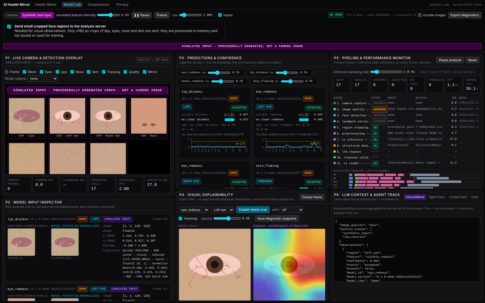
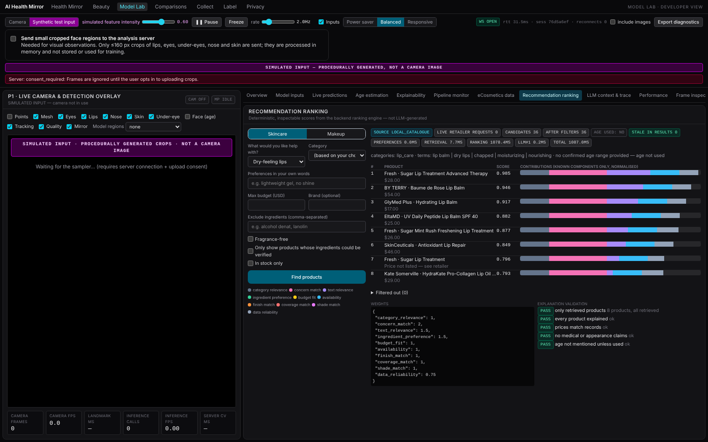

# AI Health Mirror

A multimodal AI system that looks at a webcam image, describes **visible** facial features with explicit
uncertainty, optionally estimates a broad **apparent-age** range, answers questions through a grounded LLM
assistant, and recommends **real skincare and makeup products from the eCosmetics catalogue** through an
inspectable ranking pipeline. A developer **Model Lab** shows every stage live: model inputs, probabilities,
Grad-CAM, telemetry, catalogue crawling, ranking contributions and the exact context given to the LLM.

> **Wellness education and cosmetic product discovery — not a medical device.** It describes appearance
> ("lips appear dry in this image"), never conditions. A camera cannot establish dehydration, infection, acne,
> illness or any internal condition, and apparent age is never used for health statements.



## Implemented vs. experimental vs. planned

| Status | Component |
|---|---|
| **Implemented & tested** | browser landmarking (MediaPipe) + quality gate + 11 regions; WebSocket inference with bounded latest-frame-wins queue; model registry (PyTorch / ONNX Runtime), calibrated abstention, temporal aggregation, Grad-CAM; training/evaluation framework with subject-grouped splits, MLflow, model cards and a validation gate; consented data collection + blind multi-annotator labelling; grounded LLM assistant (safety router, validators, Claude structured outputs, Ollama, offline template); eCosmetics connector (robots-enforced, targeted, logged); product catalogue (dedupe, price history, staleness, feed import); hybrid transparent recommender + grounded explanations; longitudinal comparison; privacy/deletion controls; Docker/CI |
| **Experimental (real data, not validated)** | `apparent_age` — ResNet-18 trained on FairFace (CC BY 4.0), evaluated below |
| **Demo (synthetic data only)** | the eight visual-feature classifiers (`make demo-models`) — real weights and real inference, but trained on procedurally generated images, so outputs on real faces are labelled as demonstrations everywhere |
| **Needs data / not done** | feature classifiers trained on real faces (collect with `/collect`, label with `/label`); human relevance judgments for nDCG; live test of the hosted LLM (no key in the build environment); clinical review of safety texts |

## Quick start

```bash
make setup          # CPU PyTorch + backend deps + frontend deps & MediaPipe assets
make demo-models    # optional: synthetic data + 8 DEMO feature models (~20 min CPU)
make catalog        # optional: polite eCosmetics refresh into the local DB (~12 min; see docs/data-sources/ecosmetics.md)
make age-data age-model   # optional: download FairFace (~315 MB) and train the apparent-age model (~25 min CPU)
make backend        # FastAPI :8000
make frontend       # Next.js :3000  →  /mirror  /beauty  /lab  /history  /collect  /label  /privacy
make test           # backend pytest + frontend vitest + typecheck
```

Everything degrades honestly: no models → "not loaded"; no catalogue → the Beauty page explains how to run a
refresh; no `ANTHROPIC_API_KEY` → a clearly labelled deterministic template provider. Docker:
`docker compose up --build` (backend + PostgreSQL). Deployment: [docs/deployment.md](docs/deployment.md).

## Architecture

```
Browser (camera rate)                         FastAPI backend (inference / request rate)        Offline jobs
getUserMedia → MediaPipe Face Landmarker      /ws/inference (1-slot mailbox, drops stale)        catalogue refresh
 → quality gate → region crops ──opt-in──▶     → crop quality gate → shared preprocessing         (robots · sitemap ·
   (face crop only if age opted in)            → CNN classifiers (torch | ONNX) → abstain/accept    JSON-LD parser ·
 → overlays, telemetry store, Frame Inspector  → temporal aggregation → StructuredObservations       crawl log)
                                               → [opt-in] apparent-age range (display only)          training / eval
 /api/chat ──────────────────────────────────▶ safety router → evidence → retrieval → LLM → validators   (MLflow)
 /api/recommendations ───────────────────────▶ preferences → local catalogue → filters → weighted ranking
                                               → grounded explanations → validators → trace + events
```

Diagrams and rationale: [docs/architecture.md](docs/architecture.md). Typed contracts:
`backend/app/schemas/{protocol,catalog}.py` ↔ `frontend/lib/{protocol,catalog}.ts`, field lists contract-tested,
JSON Schema exported to `shared/schemas/`. Every stage emits a `TelemetryEvent` (event id, session, frame,
timestamps, stage, status, duration, model version, structured output, error).

Module map (the brief's suggested layout → this repo): `face_landmarks` → `frontend/lib/{landmarker,regions}.ts`;
`preprocessing` → `backend/app/inference/preprocess.py`; `feature_classifiers` / `inference` →
`backend/app/inference/`; `age_estimation` → `backend/app/inference/age.py` + catalogue entry `apparent_age`;
`explainability` → `backend/app/inference/gradcam.py`; `recommendations/{scraper,catalog,ranking}` →
same paths under `backend/app/recommendations/`; `privacy` / `safety` → `backend/app/{safety,storage}`.

## Computer vision

* **Regions** from `shared/regions.json` (one definition for browser crops, server crops and alignment): lips,
  both eyes, both under-eyes, nose, forehead, both cheeks, chin, and a whole-face crop used only for age.
* **Quality gate** (browser + server): brightness, contrast, blur (Laplacian variance), face size, yaw/pitch,
  face count, region size; unusable → abstain, poor → stricter threshold.
* **Feature classifiers** (binary: visible feature vs. no clear feature; "inconclusive" is an abstention
  outcome, not a class): lip dryness, eye redness, nasal redness, skin flaking, spots/blemishes, skin
  redness, shine, under-eye darkness. Temperature-scaled; user-facing observations need agreement over
  several frames.
* **Training** (`backend/training/`): manifest loader, subject-grouped leakage-checked splits (or an official
  test split), webcam-realistic augmentation, transfer learning (ResNet/EfficientNet/MobileNet), early stopping,
  checkpoints, temperature scaling, MLflow tracking, ONNX export with parity check, model cards.
* **Tiers**: `demo` (synthetic) · `experimental` (real data) · `validated` (passes a gate: ≥ 15 people / ≥ 100
  images / ≥ 30 per class in the test split, person-grouped, annotator κ ≥ 0.6). Training refuses mismatches.

### Apparent age (opt-in)

Off by default; the face crop is sent only while the user has it on. The model returns a probability
distribution over six ranges (under 20, 20–29, …, 60+ — set by FairFace's bins), an expected age, an 80 %
plausible span, entropy and an accept/inconclusive decision. The user can confirm, correct, skip or disable it;
estimates are never stored, never sent to the LLM, and never used for ranking — only a **confirmed** range is
accepted by the recommender, and only to filter anti-aging/peel products for a confirmed under-18 range.

Held-out FairFace test split (4,000 images; from `models/apparent_age/*/eval_report.md`):

| metric | value |
|---|---|
| exact range accuracy / within ±1 range | 0.578 / 0.931 |
| MAE (expected age vs. range midpoint, approximate) | 5.8 years |
| ECE (calibration) | 0.032 |
| 80 % span contains true range | 0.882 (mean width 2.16 ranges) |
| largest subgroup gap — race / gender (accuracy) | 0.063 / 0.021 |
| robustness (blur, exposure, noise, JPEG q25) | accuracy 0.555–0.565 |
| latency (CPU, batch 1) | p50 5.4 ms |

FairFace photos are not webcam frames, labels are annotated *apparent* age, and there are no identity ids, so
expect worse live performance. Full card: [docs/model-cards/apparent_age.md](docs/model-cards/apparent_age.md).

### Feature classifiers (demo tier)

Trained on procedurally generated images ([docs/datasets.md](docs/datasets.md) explains why no suitable public
dataset exists). Synthetic test accuracy 0.90–0.955 per model ([docs/model-cards/](docs/model-cards/)) — this
only shows the pipeline works. Real-data path: `/collect` (separate, withdrawable research consent) → `/label`
(blind, κ-measured) → `make train-real MODEL=…` → tier `experimental`.

## LLM architecture

Provider-independent (`backend/app/llm/providers/`): Claude via the Anthropic SDK (`claude-opus-5-5`,
structured outputs into Pydantic models, cached static system prompt, server-side refusal fallback), any
open-weight model via **Ollama** (JSON-schema constrained), or a deterministic offline template provider.

Chat workflow: deterministic **safety router** (urgent symptoms → reviewed response, LLM bypassed) → evidence
selection (accepted observations only) → sufficiency check → curated retrieval → optional selected **product
records** → structured generation → **validators** (no diagnosis, no health score, references ⊆ evidence,
per-clause visual grounding, demo/experimental disclosure, no appearance judgements, product prices match
records, no efficacy claims) → one retry with feedback → grounded template fallback. The trace (steps, timings,
redacted context, validation, tokens) is shown in Model Lab.

## Product data pipeline (eCosmetics)

Access review, findings and limits: **[docs/data-sources/ecosmetics.md](docs/data-sources/ecosmetics.md)**. In
short: robots.txt allows product pages and is enforced per request; the REST API (401) and ajax endpoints are
never used; discovery uses the public sitemap; pages are fetched ≥ 2 s apart with an honest User-Agent, a circuit
breaker on 403/429 and a kill switch; JSON-LD is parsed first. **No user data ever reaches the retailer.**

First refresh (measured): 271 products in 12 categories (moisturisers, cleansers, serums, lip care, sunscreens,
blemish-prone care, concealers, colour correctors, foundations, skin tints, setting products, lip colour);
price available for 86 % (multi-shade listings load prices from disallowed ajax endpoints, so they show
"price not listed — see retailer", never $0), ingredient lists for only **38 %**. One HTTP 429 was received and
logged. Listings older than 72 h are marked stale.

## Recommendation algorithm

`backend/app/recommendations/ranking/engine.py` — deterministic and inspectable:

1. The **user** picks a concern or makeup goal (observations only contribute if ticked).
2. Candidates from the local catalogue by category.
3. **Hard filters**, each logged with a reason: brand, budget, stock, ingredient exclusions, fragrance-free
   (ingredient list or "scented" wording), optional strict ingredient verification, confirmed-under-18
   appropriateness.
4. **Components** in [0, 1]: category relevance, concern match (marketed claims), TF-IDF text relevance,
   ingredient preference, budget fit, availability, finish, coverage, shade, data reliability. Unknown inputs →
   `null`, excluded from the weighted mean (never treated as good or bad) and surfaced as warnings.
5. Weighted mean with configurable weights (`RECOMMENDER_WEIGHTS`); ties broken by id.
6. The LLM explains only the returned records; validators reject unknown products, wrong prices,
   efficacy/medical or appearance claims, and age mentions when age wasn't used.

Measured on the real catalogue ([docs/evaluation/recommendations.md](docs/evaluation/recommendations.md)):
ingredient-exclusion violations 0 across 8 terms; fragrance-free violations 0 of 30 returned — but 21 of those 30
were **unverifiable** (no ingredient list), which is why the strict option exists. Category precision@5 is 1.0
by construction (a weak proxy); nDCG needs human relevance judgments, which have not been collected
(template provided). Ranking latency p50 ≈ 12 ms.

LLM/pipeline evaluation ([docs/evaluation/llm.md](docs/evaluation/llm.md)): 8/8 chat cases (safety routing 2/2)
and 4/4 recommendation cases with 0 product hallucinations and 0 preference violations — **with the offline
template provider**; rerun `make eval-llm` with an API key to evaluate a hosted model.

## Real-time design

Camera rendering and landmark tracking run in the browser at display rate; classification is sampled
(0.5–10 Hz, performance presets) with one frame in flight and a 1-slot server mailbox, so stale frames are
dropped, never queued. Age runs only on opted-in frames; Grad-CAM runs on demand in a separate worker; the LLM
runs only on user messages; product retrieval is local. Measured server latency (4 vCPU, CPU only): 7 regions ×
4 models p50 ≈ 77 ms torch / ≈ 64–68 ms ONNX ([docs/performance.md](docs/performance.md)).

## Model Lab & Frame Inspector

The live camera/detection panel stays mounted on the left (so the camera never restarts); resizable tabs on the
right: Overview · Model inputs · Live predictions · Age estimation · Explainability · Pipeline monitor ·
eCosmetics data · Recommendation ranking · LLM context & trace · Performance · **Frame Inspector** (10 steps:
captured frame → detection → landmarks → preprocessing → predictions → Grad-CAM → retrieval → ranking → LLM
context → final response, Back/Next, privacy-safe export). Toolbar: input source (camera / labelled
"SIMULATED INPUT"), camera picker, mirror toggle, Power saver / Balanced / Responsive presets, pause, freeze.



**Seamless recommendations.**
* **Product ideas sidebar** on the Health Mirror (`🛍 Product ideas`, off until you open it): sits next to the
  live video, follows what the mirror notices (accepted observations → neutral chips like "Lip care") or any chip
  you tap, refreshes only when the suggestion changes, with quick fragrance-free / max-price toggles.
* **Ask in plain words** — in any chat ("recommend a fragrance-free lip balm under $15") or the Beauty search box —
  and real products come back inside the reply. A deterministic parser (`recommendations/intent.py`) turns the
  text into preferences; urgent-symptom messages are never turned into shopping.
* **Beauty page** (`/beauty`): one search box + one-tap chips, results grid, assistant alongside; detailed
  filters, camera, apparent-age opt-in and the simulated lip-colour preview are tucked into collapsible sections.
  When a budget or fragrance-free is set, products verified to match are listed before ones whose price or
  ingredients couldn't be checked.

Verified in headless Chromium against the real catalogue with synthetic input and a fake camera. **Not yet
verified on a real face/webcam:** AR lip alignment, the Frame Inspector's camera-frame/landmark steps, live
age estimates and camera switching between real devices.

## Privacy & safety

Camera only on explicit click with an active indicator; nothing recorded; region crops only after opt-in and
never persisted; age off by default and never stored; snapshots and training data each need their own consent
and are fully deletable; no data to the retailer; secrets server-side; dev endpoints behind a token; chat not
logged by default. No HIPAA or medical-device claims. [docs/privacy-and-safety.md](docs/privacy-and-safety.md).

## Testing

Backend pytest (`make test-backend`): CV geometry and alignment, preprocessing parity, schema contracts, inference,
abstention, Grad-CAM, ONNX parity, telemetry ordering, WebSocket consent/backpressure/reconnect, safety router,
validators, agent retry/fallback, Anthropic provider (mocked), data collection/withdrawal/κ, tiers and gate,
**catalogue parsing, robots/policy enforcement (no request made for denied URLs), rate-limit circuit breaker,
incremental refresh, dedupe, price history, staleness, feed import, ranking filters/missing-data neutrality/
determinism/age gating, explanation validation, recommendation API events, product chat grounding, age opt-in
gating and isolation, age metrics**. Frontend vitest + typecheck + lint + build. CI: `.github/workflows/ci.yml`.

## Limitations & future work

* Feature classifiers need real, consented, labelled webcam data before their outputs mean anything.
* The age model is FairFace-trained; webcam domain shift and subgroup gaps need measurement on consented
  webcam data; the under-20 range cannot distinguish minors.
* 62 % of catalogue listings lack ingredient lists; multi-shade prices and shade lists are not on permitted pages.
* Keyword-based triage and heuristic validators are safety nets, not guarantees; safety texts need clinical review.
* Planned: human relevance judgments + nDCG, hosted-LLM evaluation runs, Redis-backed sessions for horizontal
  scale, an authorised retailer feed, calibrated shade matching with a reference card.

Status by phase: [docs/status.md](docs/status.md). Plan and access review: [docs/implementation-plan-v2.md](docs/implementation-plan-v2.md).
