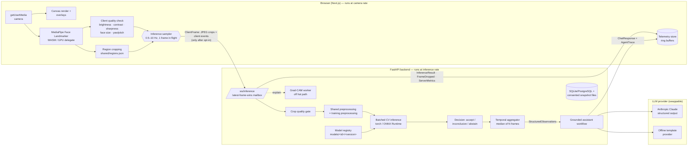

# System Architecture

## Overview

## Why the work is split this way

| Decision | Rationale |
|---|---|
| Landmarks in the browser (MediaPipe WASM) | Runs at camera FPS with no network round-trip; raw frames never leave the device by default. |
| Server receives only small region crops (≤160 px JPEG) | Bandwidth and privacy: a full 720p frame is ~100 KB+, crops for 7 regions are a few KB each. |
| Separate inference sampler with one frame in flight | Camera rendering never waits on the server; the inference rate is explicit, adjustable and measured independently. |
| Latest-frame-wins mailbox on the server | Stale frames are dropped (and reported as `frame_dropped{superseded}`) instead of queueing — bounded memory, bounded latency. |
| CPU work in thread pools | The asyncio event loop only does I/O; inference and Grad-CAM can't stall pings/metrics. |
| Shared `regions.json` | One definition of each region for browser cropping, server-side cropping (`/api/inference/image`) and longitudinal alignment. |
| Shared preprocessing function | `training/data.py` imports `app.inference.preprocess.preprocess`, so the tensor at serving time is produced by the code the model was trained with (tested). |
| Binary classes + abstention instead of an "inconclusive" class | Annotators label what they see; uncertainty is handled by calibrated thresholds and quality gates that can be tuned without retraining. |
| Temporal aggregation | Per-frame predictions are noisy (blinks, motion). User-facing observations use the median of the last N usable frames and need ≥ M frames. Model Lab still shows raw per-frame output. |
| LLM sees only structured observations | The LLM cannot hallucinate visual findings it was never given, and every claim it makes is checked against accepted evidence. |
| Deterministic safety triage before the LLM | Urgent complaints get a predetermined, reviewable response; they are never routed through a speculative model. |

## Pipeline stages and telemetry

Every stage emits a `TelemetryEvent` (`backend/app/schemas/protocol.py`) with `session_id`, `frame_id`,
`stage`, `status` (`ok|warning|error|skipped`), `origin` (`client|server`), `started_at` (epoch ms),
`duration_ms`, input/output types, model id/version and a per-origin `seq` used to verify ordering.

| Stage | Where | Input → Output |
|---|---|---|
| camera_capture | browser | MediaStream → video frame |
| image_quality | browser + server | frame / crops → `ImageQuality` |
| face_detection, landmark_extraction | browser | frame → 478 landmarks |
| region_cropping | browser (or server for `/api/inference/image`) | landmarks → JPEG crops |
| preprocessing | server | RGB uint8 → float32 NCHW |
| cv_inference | server (per model) | tensors → class probabilities |
| structured_observations | server | predictions → aggregated `StructuredObservations` |
| llm_request, response_validation | server (chat) | context → `AssistantReply` → checks |
| ui_render | browser | result → DOM |

Camera FPS, landmark FPS and inference FPS are computed separately from real timestamps; the UI never
implies they are equal.

## Extensibility

* **New CV model:** add a `CatalogEntry` in `backend/app/inference/catalog.py`, provide a manifest,
  run `python -m training.train --model-id <id> ...`. The registry discovers it; the UI picks it up from
  `ModelInfo`.
* **New LLM provider:** implement `generate(LLMRequest) -> LLMResult` (`app/llm/providers/base.py`) and
  register it in `make_provider`.
* **New runtime:** `LoadedModel.predict_logits` is the only call site (torch and ONNX implemented).
* **New storage:** `HistoryStore` uses SQLAlchemy Core; any SQLAlchemy URL works (`DATABASE_URL`).
* **Retrieval:** `retrieve(query, evidence_keys)` can be swapped for a vector store without touching the agent.

## Wire contract

`backend/app/schemas/protocol.py` is the source of truth. `frontend/lib/protocol.ts` mirrors it;
`shared/schemas/protocol.schema.json` is generated by `scripts/export_schemas.py`. Tests fail if the TS field
lists or the exported JSON Schema drift from the Pydantic models. See [`api.md`](api.md).
